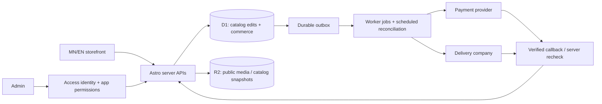

# GenZST: admin, бараа, төлбөр, хүргэлтийн хэрэгжүүлэх төлөвлөгөө

Огноо: 2026-11-17. Төлөв: төлөвлөлт; энэ баримт бичиг боломжуудыг хэрэгжсэн гэж батлахгүй.

## 1. Зорилго ба хамрах хүрээ

Дэлгүүрийн эзэн код засахгүйгээр үнэртэй ус нэмэх, бүх мэдээллийг засах, урд/ар зураг оруулах, үнэ/хэмжээ/нөөц удирдах, бараа нийтлэх/нуух/худалдааг түгжих, захиалга боловсруулах, төлбөр шалгах, хүргэлтийн компанид захиалга явуулах боломжтой болно. Худалдан авагчийн дэлгүүр, admin, backend нэг бодит өгөгдлөөр ажиллана.

Эхний ажил: баримтжуулах ба agent-д хуваарилах. Код хэрэгжүүлэх, үйлчилгээ худалдан авах, production deployment хийх нь энэ төлөвлөлтийн гүйцэтгэл биш.

Үндсэн хувилбарт: нэг дэлгүүр, MNT, guest checkout, нэг хүргэлтийн provider, банкны шилжүүлэг, тохиргоотой бол QPay, MN/EN storefront. Admin-ийн үндсэн хэл Монгол. Marketplace, олон агуулах, нягтлан бодох бүрэн систем, loyalty, subscription эхний хувилбарт орохгүй. Цахим баримт/татварын интеграц шаардлагатай эсэхийг эзэн үйлчилгээний байгууллагатайгаа тогтоож, шаардлагатай бол launch dependency болгоно.

## 2. Одоогийн кодоор батлагдсан суурь

| Хэсэг | Одоогийн байдал | Цааш хийх зүйл |
|---|---|---|
| Stack | Astro 5, Preact, TypeScript, Cloudflare adapter | Одоогийн stack-ийг үргэлжлүүлэх |
| Admin | `src/pages/admin.astro`: token login, orders, inventory хоёр tab | Бүрэн admin navigation, role, form, dashboard |
| Backend | `/api/orders`, `/api/admin/orders`, `/api/admin/inventory`, order lookup | Салангид service, бүтээгдэхүүн/payment/delivery API |
| Database | `0001_orders.sql`, `0002_backend.sql`: orders, events, inventory overrides, rate limits | Нэмэх migration; хуучин захиалгыг хадгалах |
| Үнэ/үлдэгдэл | Checkout D1 override уншина; storefront build-time JSON ашиглана | Public UI, admin, checkout-ийг D1 commerce өгөгдөлд холбох |
| Stock | Tracked inventory дээр D1 batch + nonnegative CHECK бий | Нийт хэмжээгээр хуваалцсан decant stock, reservation, expiry |
| Давхар захиалга | Idempotency key бий; payload fingerprint алга | Key + canonical request fingerprint, concurrency test |
| Захиалгын төлөв | Нэг `status` дотор paid/shipped/done холилдсон | Order/payment/fulfillment төлөв тусдаа |
| Төлбөр | bank/qpay сонголт, жишээ банкны мэдээлэл | Жинхэнэ invoice, reconcile, protected manual confirmation |
| Хүргэлт | Fee тооцдог; company API route алга | Provider adapter, outbox, tracking, retry/reconciliation |
| Account | `src/lib/account.ts`: localStorage demo | Guest secure tracking; real account зөвхөн server session-тэй |
| Catalog | `decantx/catalog.json` ба R2 mapping/schema бэлэн | Admin CRUD, тогтвортой ID, publish/version урсгал |
| Infra | Root Wrangler: placeholder D1 ID, Turnstile test key | Preview/production тусгаарлах, real auth/secrets |

Одоогийн inventory/cancellation хамгаалалт байгаа тул бүгдийг шинээр солих шаардлагагүй. Гэхдээ бүрэн урсгал, бодит provider болон production ажиллагаа энэ аудитад туршигдаагүй. `docs/CLAUDE-BACKEND-HANDOFF.md`-ийн өмнөх тайлбараас илүү одоогийн код, энэ өргөтгөсөн хамрах хүрээг баримтална.

## 3. Admin-ийн дэлгэцүүд

| Menu | Хэрэглэгчийн хийх ажил |
|---|---|
| Хяналтын самбар | Өнөөдөр/7 хоног/сар, төлбөр батлагдсан нийт дүн, буцаасан дүн, цэвэр хүлээн авалт; шинэ захиалга, төлбөр хүлээсэн, бэлтгэх/хүргэх захиалга; бага нөөц, алдаатай интеграц |
| Захиалга | Хайлт, хугацаа/payment/fulfillment filter, pagination, дэлгэрэнгүй, timeline, дотоод тэмдэглэл, invoice/tracking, зөвшөөрөгдсөн action |
| Үнэртэй ус | Жагсаалт, шинээр нэмэх, draft хадгалах, preview, нийтлэх, нуух, архивлах, олон сонголтоор үйлдэл хийх |
| Үнэ ба хувилбар | Decant/full bottle, SKU, ml, үнэ, хямдралын хугацаа/үнэ, худалдааны төлөв |
| Нөөц | Орлого, зарлага, засварын шалтгаан, reserved/allocated/available, бага үлдэгдэл, хөдөлгөөний түүх |
| Төлбөр | Unpaid/paid/refund review, QPay invoice, банкны тулгалт, гараар батлах, давхар гүйлгээ, зөрүүтэй төлбөр |
| Хүргэлт | Илгээхэд бэлэн, company рүү явуулах, илгээсэн, tracking, алдаа/тодорхойгүй хариу, дахин тулгах, буцаалт |
| Зураг/медиа | Урд/ар/нэмэлт зураг, preview, дараалал, солих, ашиглаж буй reference |
| Дэлгүүрийн тохиргоо | Checkout нээх/хаах, payment method, delivery zone/fee, холбоо барих, банкны мэдээлэл, үйлчилгээний тайлбар |
| Ажилтан ба түүх | Role/эрх, идэвхгүй болгох, audit log; зөвхөн owner |

Desktop table + mobile card/detail; loading, empty, validation, permission denied, provider unavailable, conflict үед ойлгомжтой төлөвтэй. Form нь unsaved-change анхааруулга, draft хадгалалт, optimistic concurrency-тэй. Нэг ажилтны засварыг нөгөө нь санамсаргүй дарж хадгалахгүй.

Dashboard нь server aggregation ашиглана. Invoice үүссэнийг борлуулалтад тооцохгүй. Paid amount, refunded amount, net collected-ийг тусад нь харуулна; ашиг тооцох бол бодит өртөг шаардлагатай. Хугацааны зааг Asia/Ulaanbaatar; DB timestamp UTC. Эхний хувилбар нэг order = нэг бүтэн shipment, split shipment дараагийн өргөтгөл.

## 4. Барааны мэдээлэл ба зураг

### Үнэртэй усны мэдээлэл

- Тогтвортой ID, өөрчилж болох slug + хуучин slug redirect; brand, нэр, concentration, release year.
- MN/EN тайлбар, gender/unisex/unknown, fragrance family, top/heart/base notes, accords.
- Season/occasion, intensity, perfumer, гарал зэрэг нэмэлт optional field; unknown утга зөвшөөрнө. Баримтгүй projection/rating/longevity зохиохгүй.
- Үйлдвэрийн бүтэн савны хэмжээ (`bottle_sizes_ml`) ба дэлгүүрийн худалдах хувилбарыг ялгана.
- Хэрэгцээтэй field бүр form validation, max length, төрөл, null утгын дүрэмтэй байна. Source/provenance нь admin-only.
- Нүүрний featured/bestseller сонголт, display order, SEO title/description, slug canonical.

### Худалдах хувилбар

- `sku`, `kind: decant | full_bottle`, `size_ml`, MNT integer price, optional compare-at/хямдрал, active/sales_locked.
- Нэг perfume-ийн олон бүтэн савны хэмжээг зөвшөөрнө; одоогийн нэг `full` хувилбарын schema-г хязгаар гэж өвлөхгүй.
- Stock source: decant бол bulk ml pool; бэлэн савласан бараа бол unit pool. Урьдчилж савласан decant бас unit pool ашиглаж болно. Нэг шингэнийг хоёр pool-д зэрэг бүртгэж болохгүй; савлах movement-ээр шилжүүлнэ.
- Үнэ, нөөц, зардал, захиалга нь public master catalog-д орохгүй. Public shop API нь зөвхөн худалдан авагчид хэрэгтэй selling price/availability буцаана.

### Зураг

- `front`: савны урд; `back`: сав+хайрцаг/ар талын reference; шаардлагатай бол gallery нэмнэ. Хуучин mapping болон утгыг хадгална.
- Upload → хэмжээ/MIME/file signature шалгах → resize/encode → R2 immutable object → D1 media record → draft preview → publish.
- Зөвшөөрөгдсөн raster төрөл ба дээд хэмжээ, pixel хэмжээ тогтооно. EXIF цэвэрлэх; raw HTML/SVG оруулахгүй. Remote URL import бол allowlist ба SSRF хамгаалалттай тусдаа ажил.
- Зураггүй бараанд бодит fallback; өөр үнэртэй усны зураг тавихгүй. Alt text ба reference ашиглалтыг хадгална.
- Зураг солиход шинэ object key ашиглана; хуучин захиалга/кэшийн холбоосыг эвдэхгүй. Reference-тэй media устгахгүй, orphan cleanup хугацаатай.
- Receipt, customer address, shipment label зэрэг хувийн файл public image bucket-д орохгүй; шаардлагатай бол private storage + эрх шалгасан download.

## 5. Нуух, түгжих дүрэм

Дараах нь хэрэглэгчийн хариугаар нарийвчлах урьдчилсан утга.

| Удирдлага | Storefront | Backend |
|---|---|---|
| Product `draft` | Public-д байхгүй | Худалдан авах боломжгүй |
| Product `published` | Жагсаалт/detail-д харагдана | Active, unlocked SKU + бодит үнэ + available stock байвал зарна |
| Product `hidden` | Search/list/detail/public API-д байхгүй | Хуучин cart/direct API-аас захиалах боломжгүй |
| Product `archived` | Public-д байхгүй | Түүх хадгалагдана; hard delete хийхгүй |
| Product/SKU `sales_locked` | Бараа харагдана, худалдан авах товч хаалттай | Шинэ order/reservation хориглоно |
| Payment method `enabled=false` | Шинэ checkout-д сонголтгүй | Шинэ invoice/payment initiation хориглоно |
| Checkout `enabled=false` | Дэлгүүр үзэж болно, тайлбар харагдана | Шинэ order/reservation/payment initiation хориглоно |

Хаалт нь зөвхөн UI биш, серверийн шалгалт байна. Setting өөрчлөх бүр actor, before/after, reason хадгална. Нууцалсан барааны өмнө нь татагдсан зураг/мэдээллийг хэрэглэгчийн төхөөрөмжөөс буцааж устгах боломжгүй; цаашдын public response ба cache-ийг цэвэрлэнэ.

Payment method/checkout хаахад өмнө үүссэн invoice-ийг чимээгүй хүчингүй болгохгүй. Callback, payment check, refund, одоо байгаа order tracking үргэлжилнэ. Идэвхтэй invoice цуцлах нь тусдаа audited action, provider-ын бодит боломжтой таарна. Бүх payment method хаалттай бол шинэ checkout ч хаагдана.

## 6. Архитектур ба өгөгдлийн эзэмшил

### Catalog edit шийдвэр

Одоогийн R2 master-ийг нэг удаа баталгаажуулан D1 catalog record руу import хийнэ. Үүнээс хойш admin-ын mutable catalog болон commerce-ийн authoritative data нь D1 байна. R2 catalog JSON нь баталгаажсан public facts-ийн versioned export/snapshot болно; хоёр талд давхар засвар хийхгүй. Publish/export outbox ба revision ашиглаж export failure-ийг dashboard-д харуулна. Snapshot файл дахь commerce өгөгдөлгүй дүрэм хэвээр.

Одоогийн `catalog.schema.json` яг 1,000 entry гэж хязгаарладаг. Шинэ бараа нэмдэг болохдоо schema-г version-оор өөрчилж, анхны 1,000 identity/image association-ийг regression check-ээр хадгална. Баримтгүй metadata null хэвээр. Import дахин ажиллахад admin price/stock болон засварыг дарж бичихгүй; зөрүүг review болгоно.

### Runtime

- Одоогийн Astro/Preact/Workers-ийг ашиглана; өөр backend stack нэмэхгүй.
- Shop listing/detail болон public commerce API нь D1-ийн нийтлэгдсэн хувилбарыг уншина. Шинэ slug/detail нь rebuild шаардахгүй server route байна. Static MN/EN route/getStaticPaths-ийг A5 шалгаж өөрчилнө.
- Public cache зөвхөн нийтэлсэн safe data-д; revision/invalidation-тэй. Үнэ/availability refresh нь cart, checkout дээр server revalidation-тай. Admin settings/lock нь write transaction үед дахин шалгагдана.
- D1 unavailable бол хуучин/demo үнээр order хүлээж авахгүй. Private API response `no-store`.
- D1 outbox + scheduled Worker-оор эхэлж болно. Scheduler binding/entrypoint-ийг A0 батална; Astro build-д cron өөрөө бий болно гэж үзэхгүй. Queues ашиглах бол бодит plan/limit-ийг шалгаж, шаардлагатай үед нэмнэ.
- Provider secret-ийг environment secrets-д; admin UI нь secret value буцааж харуулахгүй, зөвхөн configured/status харуулна.

## 7. Database загвар

Доорх нь contract drafting-ийн зорилтот model. A0 canonical SQL, FK, CHECK, index, migration/backfill болон enum-ийг нэг мөр болгоно.

| Entity | Гол утга / constraint |
|---|---|
| `catalog_products`, `catalog_translations` | stable id, slug unique, metadata, publication, sales lock, revision |
| `brands`, `notes`, `product_notes`, `product_attributes` | Structured taxonomy; top/heart/base ба locale label; хязгаарлагдсан optional attributes |
| `slug_redirects` | Хуучин URL → stable product, redirect loop үүсэхгүй |
| `media`, `product_media` | R2 key, public/private classification, slot/order, reference |
| `offers` | product_id, unique SKU, kind, ml, price MNT integer, active, lock, stock pool, version |
| `stock_pools`, `stock_movements` | unit/ml хэмжээс, on_hand, reserved, allocated; movement unique reference |
| `reservations`, `reservation_lines` | order/pool consumption, expires_at, active/allocated/released/consumed |
| `orders`, `order_items`, `order_events` | Хуучин orders-ийг нэмэлт migration-аар өргөтгөнө; immutable line/address/fee snapshot |
| `idempotency_records` | scoped key unique, fingerprint, operation state/result, expiry |
| `payments`, `payment_events`, `refunds` | invoice/payment IDs unique by provider, amount/currency, verification/refund түүх |
| `shipments`, `shipment_events` | Нэг order-д нэг live shipment; provider ref, tracking, status, request version |
| `outbox_jobs`, `webhook_inbox` | Unique event/job key, attempt, due_at, lease, status; event dedupe |
| `admin_users`, `roles`, `audit_log` | Access subject → active app role, before/after, actor, reason |
| `store_settings`, `delivery_zones` | Versioned settings; зөвшөөрөгдсөн public projection |
| `guest_order_access` | High-entropy token hash, order scope, expiry/revocation; full token DB/log-д үлдэхгүй |
| `customers`, `customer_sessions` | Зөвхөн real account оруулах үед verified identity/session; demo history шилжүүлэхгүй |

FK/index: order_no, SKU, slug, provider invoice/shipment/payment ID, event dedupe key unique; listing filter+pagination, product_id, status+created_at, jobs status+due_at, reservation expiry indexed. Том жагсаалтад bounded page size/cursor. Мөнгө integer MNT; DB timestamps UTC.

## 8. Захиалга ба нөөцийн урсгал

1. Cart үнэ бол preview. Checkout quote нь active offer, lock, stock, delivery zone/fee, enabled payment-ийг серверээр тооцно.
2. Order submit: bounded body stream, schema, abuse checks, idempotency fingerprint; D1 transaction дотор settings/offer version болон stock-ийг баталгаажуулж reservation + order snapshot + event + outbox үүсгэнэ.
3. Бүх мөр хамт амжилттай, эсвэл нэг ч өөрчлөлтгүй. Сүүлийн нөөц, өөр ml хэмжээ нэг pool ашиглах, алга болсон inventory мөр, зэрэг price change, давхар submit-ийг test хийнэ. Zero-row update-ийг автоматаар rollback болно гэж үзэхгүй.
4. Provider API call-ийг database transaction дотор хийхгүй. Order үүсээд invoice timeout бол existing order дээр reconcile/retry хийнэ; шинэ order үүсгэхгүй.
5. Банк/QPay төлбөр батлагдвал `reserved → allocated`; төлбөртэй бараанд unpaid expiry үйлчлэхгүй. Хүргэлтийн компани хүлээн авсан handover үед `allocated` болон `on_hand`-ийг нэг удаа бууруулна.
6. Төлбөргүй expiry/cancel нь reserved хэмжээг нэг удаа чөлөөлнө. Paid боловч handover болоогүй цуцлалт allocation чөлөөлж refund workflow эхлүүлнэ. Shipped/delivered барааг cancel дараад шууд stock нэмэхгүй; return received + inspection action шаардана.

Available = on_hand − reserved − allocated, бүх тоо nonnegative. Decant pool дээр 10ml × 3 = 30ml; 5ml болон 10ml нэг эх үүсвэрээс хасагдана. Prepacked unit SKU-ийн хэмжүүр нь ширхэг. Packing/loss/adjustment хөдөлгөөн шалтгаан, actor-той.

Unpaid reservation TTL-ийг тохиргоотой болгоно. Жишээ local test policy: QPay 30 минут, банк 2 цаг; эдгээр нь эзний баталсан business policy биш. Provider invoice expiry, төлбөр хожуу орох, expiry scheduler зэрэг ажиллах үед дүнг дахин тулгана. Expired/cancelled order-д мөнгө ирвэл `payment_review`; stock-гүй order-ийг автоматаар paid/fulfillable болгохгүй. Эзэн нөхөн батлах эсвэл refund шийднэ.

Төлөвүүд тусдаа:

- Order: `pending_payment → confirmed → completed`; салбар нь `cancelled | expired | review`.
- Payment: `unpaid → pending → paid → partially_refunded | refunded`; invoice attempt нь failed/expired байж болно. Verified paid-ийг хожуу pending callback буцаахгүй.
- Fulfillment: `unfulfilled → preparing → ready → dispatch_pending → accepted → in_transit → delivered`; салбар нь `failed | cancelled | returning | returned`.

Эдгээрийн transition matrix ба cross-state guard-ийг A0 батална. Dashboard статусыг нийлүүлж харуулж болох ч storage-д хооронд нь сольж хэрэглэхгүй. Legacy төлөв mapping-ийг migration report-оор шалгана; хуучин `paid` утгаас provider verification түүх зохиохгүй.

## 9. Төлбөр

### Банкны шилжүүлэг

Бодит банк/данс/эзэмшигч/гүйлгээний утга болон order-ийн яг дүнг харуулна. Screenshot дангаараа paid болгохгүй. Owner/finance нь банкны бодит орлоготой тулгаж reference, amount, note-оор батална. Давхар bank reference хамгаалалттай; алдаатай confirmation-ийг audit-гүй засахгүй. Bank config өөрчлөгдсөн ч өмнөх order-ийн instructions snapshot хадгалагдана.

### QPay

Бодит merchant бүтээгдэхүүн, гэрээ, API version, sandbox/production endpoint, callback шаардлагыг албан ёсны docs ба merchant тохиргоотой тулгаж байж хэрэгжүүлнэ. Нэг хуучин SDK-ийн endpoint-ийг бүх QPay account-д шууд хэрэглэхгүй.

Invoice ID, amount, currency, order, expiry DB-д хадгална; QR/deeplink-ийг provider response-оос үзүүлнэ. Browser return/«төлсөн» товч/notification дангаараа paid биш. Callback нь тухайн бүтээгдэхүүний supported auth-аар шалгагдаж, backend provider payment check/reconciliation-оор invoice, amount, currency, merchant/order холбоос баталгаажуулна. Давхардсан/дараалал сольсон event, timeout, refund, partial/overpayment-ийг review-тэй боловсруулна.

Credential байхгүй QPay disabled байна. Manual refund нь бодитоор хийсэн шилжүүлгийн нотолгоог бүртгэнэ; automatic refund зөвхөн provider-ын гэрээ/API дэмжсэн үед. Хэрэгжээгүй automatic refund-ийг амжилттай мэт харуулахгүй.

## 10. Хүргэлтийн компанид web request явуулах

Жинхэнэ company тодроогүй тул endpoint/payload/auth зохиохгүй. Backend provider interface: `createShipment`, `findByMerchantReference`, `getStatus`, `cancelShipment`, optional `quote`/`getLabel`. Provider боломжгүй method-ийг feature capability-гаар илэрхийлнэ.

Урсгал:

1. Paid + хаяг/утас баталгаажсан + бэлтгэсэн order дээр «Хүргэлтэд илгээх» товч.
2. Admin нь customer name/phone, city/district/khoroo, дэлгэрэнгүй хаяг, хүргэлтийн note, pickup/contact, package count/weight, шаардлагатай бол value-г preview хийнэ. Provider-д шаардлагатай хамгийн бага мэдээлэл явуулна.
3. Server нь permission, allowed state, payment rule, active shipment-ийг шалгаад unique dispatch job үүсгэнэ. Browser-оос company secret ашиглахгүй.
4. Outbox worker HTTPS request → provider shipment ID/tracking хадгална. Accepted нь delivered гэсэн үг биш. Request status ба business shipment status тусдаа.
5. Timeout бол `unknown/reconcile_required`; merchant reference-ээр хайж provider дээр үүссэн эсэхийг тогтооно. Provider idempotency/search дэмжихгүй бол автоматаар create retry хийхгүй, owner review. Давхар хүргэлт үүсгэхээс хамгаална.
6. Verified webhook эсвэл scheduled polling tracking шинэчилнэ. Invalid/replayed/out-of-order callback хамгаалалттай. Retry backoff, job lease, max attempts, failed-job queue, manual reconcile, audit байна.
7. Cancel, failed delivery, return, address correction нь provider capability ба handover төлөвтэй таарна. Хаягийн засварт version conflict шалгаж re-dispatch заавар өгнө.

Company API байхгүй бол CSV/export эсвэл owner-аар гараар booking хийж tracking бүртгэх урсгал ажиллана. Үүнийг автомат company integration гэж нэрлэхгүй. «Бүрэн автомат хүргэлт» хүлээн авахын тулд company sandbox/controlled real booking verification зайлшгүй.

COD эхний хувилбарт disabled. Дараа нэмбэл төлбөртэй shipment rule, cash collection, provider settlement/reconciliation-ийг тусдаа хэрэгжүүлнэ.

## 11. Auth, эрх, найдвартай ажиллагаа

- Санал: owner/staff admin-д Cloudflare Access identity + D1 app role. Backend JWT signature/issuer/audience/expiry шалгана; forged header, alternate workers.dev origin-оор тойрох боломжгүй. Production-д shared browser token login-ийг хаана.
- Role: owner бүх эрх; catalog editor metadata/media/offer; fulfillment order/address/shipment; finance payment/refund. Catalog editor төлбөр батлахгүй, fulfillment secret/role удирдахгүй. Owner role нь заавал; бусдыг хэрэгцээгээр нээнэ.
- Cookie session ашиглавал HttpOnly/Secure/SameSite, CSRF/Origin хамгаалалт, expiry/revocation. Staff disable дараагийн request-ээс мөрдөнө. Sensitive action-д тодорхой confirmation UI + reason.
- Guest order үүсэхэд high-entropy order-scoped access token олгоно; хадгалсан hash-аар шалгана. Order number/phone suffix дангаараа хувийн хаяг/түүх авах эрх биш. Token URL/log/referrer-ээр алдагдахгүй exchange/session flow хэрэглэнэ.
- Real customer account шаардлагатай бол verified identity provider ба session-тай тусдаа gate; OTP provider байхгүйг нууж fake login хийхгүй. LocalStorage demo-г бодит account мэт үлдээхгүй.
- Turnstile server verification, shared rate limits (амжилтгүй оролдлогод ч), bounded streamed body, prepared SQL, safe error, audit/log redaction.
- Health/readiness, failed payment/shipment jobs, expiry backlog, catalog export failure, бага stock-д admin alert. Telegram бол optional notification; notify failure захиалга буцаахгүй.
- Local/preview/production нь тусдаа DB, callback URL, secret, bucket prefix. Backup/export ба restore rehearsal, migration rollback/runbook, log retention/PII access policy бэлэн байна.

## 12. API гэрээний эхний хүрээ

A0 OpenAPI болон shared TypeScript schema-г canonical болгоно. Доорх нь feature зааг; эцсийн path/DTO-г A0 нэг удаа тогтооно.

| API group | Зорилго |
|---|---|
| Public `GET /api/shop/products`, `/:slug`, `/settings` | Safe published product/offer, filter/cursor, current availability |
| Public `POST /api/checkout/quote`, `/api/orders` | Server quote, order+reservation+snapshot |
| Order-scoped `GET /api/orders/:no`, `POST /:no/payment-check` | Safe tracking/payment refresh; access token/session шаардлагатай |
| Admin `/api/admin/products`, `/:id`, `/:id/publication`, `/:id/offers` | CRUD, versioned publish/hide/lock |
| Admin `/api/admin/media`, `/stock/adjustments`, `/settings` | Validated upload, stock movements, toggles |
| Admin `/api/admin/orders`, `/:no`, `/:no/actions/*` | Search/detail, explicit business actions |
| Admin `/api/admin/payments/*`, `/shipments/*` | Confirm/review/refund, dispatch/reconcile/cancel |
| Admin `/api/admin/dashboard`, `/audit`, `/users` | Aggregates, audit, role management |
| Provider `/api/webhooks/payments/:provider`, `/shipping/:provider` | Provider verification + inbox dedupe; admin login шаардахгүй |

Envelope: success нь `{ok:true,data,requestId}`, error нь `{ok:false,error:{code,message,fieldErrors?,retryable},requestId}`; list нь `nextCursor`-тай. Хуучин API-г шилжүүлэх compatibility adapter ба deprecation-ийг A0 тодорхойлно. Conflict = 409, validation = 422, authentication = 401, forbidden = 403, provider/backend unavailable = 503; raw provider error/secrets буцаахгүй. Mutation нь idempotency key болон шаардлагатай үед `expectedVersion`-той.

## 13. Agent-д хуваах ба дараалал

| ID | Санал болгох agent | Ажил | Dependency |
|---|---|---|---|
| A0 | Claude — architecture/backend lead | Code audit, contract, migrations, auth, shared core, import plan, job infrastructure | Эхэлж |
| A1 | Claude эсвэл өөр backend agent | Catalog/offer/media/stock CRUD, import/export | A0 frozen contract |
| A2 | Backend agent | Order, reservation, payment, expiry/refund | A0 frozen contract |
| A3 | Devin эсвэл integration agent | Delivery adapter, outbox processing, tracking/reconciliation | A0 + company docs; A2 paid contract |
| A4 | Devin эсвэл frontend agent | Admin dashboard ба бүх admin screen | A0 contract; A1–A3 API дагуу |
| A5 | Storefront agent | Runtime storefront/cart/checkout/success/tracking, MN/EN integration | A0 contract; A1/A2 endpoints |
| A6 | Тусдаа reviewer/integrator | Cross-module integration, security/concurrency/E2E, preview, release runbook | Бүх module merge |

Энэ бол санал болгосон role allocation; ямар бүтээгдэхүүний agent хурдан/сайн гэж батлахгүй. Agent-ууд руу энэ төлөвлөлтийн үед автоматаар даалгавар илгээгээгүй.

Дараалал: **A0 → A1/A2/A3 parallel + A4/A5 contract fixtures → интеграц → A6 verification → launch configuration → production acceptance**.

Parallel гэдэг нь хүн/agent тусдаа branch/worktree дээр ажиллахыг хэлнэ. A0-оос өмнө бүгд schema зохиож эхлэхгүй. `migrations`, shared contracts/auth/settings, root Wrangler config, dependencies/lockfile-ийг зөвхөн A0/integrator өөрчилнө. Бусад нь migration request өгнө. A4 admin UI, A5 storefront UI; integration-specific backend file ownership давхардахгүй. API contract өөрчлөлтийг version/approval record-оор бүх agent-д хүргэнэ.

Хуулж өгөх тусдаа даалгаврууд: [ADMIN-AGENT-TASKS.md](./ADMIN-AGENT-TASKS.md).

## 14. Ажлыг дууссан гэж хүлээж авах шалгуур

| # | Бодитоор харуулах үр дүн |
|---|---|
| 1 | Admin шинэ perfume, MN/EN тайлбар, front/back upload, decant + олон bottle SKU үүсгэж draft → preview → publish; rebuild-гүйгээр public дээр гарна |
| 2 | Анхны catalog ID/image холбоос хадгалагдсан, дахин import owner data дарахгүй, unknown metadata зохиогдоогүй |
| 3 | Hide/lock/checkout/payment toggle нь UI болон direct API/cart replay дээр мөрдөгдөнө; admin өөрөө түгжигдэхгүй |
| 4 | Үнэ/fee tampering үл нөлөөлнө; quote ба submit хооронд үнэ өөрчлөгдвөл хэрэглэгч дахин зөвшөөрөх recoverable conflict |
| 5 | Сүүлийн stock-ийн зэрэг хоёр order; shared decant cross-size; missing row; нэг буруу line → oversell/partial write үүсэхгүй |
| 6 | Same key + same payload зэрэг retry → нэг order/invoice/reservation; өөр payload → 409 |
| 7 | Unpaid expiry/cancel нэг удаа release; paid stock хэвээр allocated; shipped cancel нь шууд restock хийхгүй |
| 8 | Bank confirmation finance permission + reference-тэй; fake receipt/browser paid flag/callback → paid болохгүй |
| 9 | QPay enabled бол sandbox invoice → provider verified payment → paid; duplicate/late/wrong amount/timeout/expiry race tested |
| 10 | Paid ready order → нэг shipment request; timeout reconcile, repeated click, webhook replay/out-of-order tested; credentials байхгүйг тодорхой харуулна |
| 11 | Guest token/customer ownership, forged Access JWT, staff permissions, CSRF, alternate origin, private media access бүгд шалгагдсан |
| 12 | Dashboard зөв paid/refund aggregates; jobs/reconciliation backlog, audit actor/reason зөв харагдана |
| 13 | Mobile/desktop MN/EN listing/detail/cart/checkout/success/tracking/admin чухал зам ажиллана; R2 cart зураг refresh дараа хэвээр |
| 14 | Existing DB data migration/backup/restore verified; preview real D1 ба configured provider test evidence; secrets/private data build-д байхгүй |
| 15 | `npm.cmd run check`, `npm.cmd run build`, meaningful integration/concurrency/security/E2E checks pass; өмнөх test-ийн хамгаалалт алдагдаагүй |

Mock test, local test, remote preview test, provider test, production verification-ийг тусад нь тэмдэглэнэ. «Ажиллаж байна» гэдэг нь зөвхөн UI render эсвэл 200 response биш; storage, provider state, inventory, ownership-ийг хамтад нь тулгасан байна.

## 15. Эзнээс хэрэгтэй мэдээлэл ба launch gate

Төлөвлөлт/суурь implementation-ийг эдгээрийг хүлээн зогсоохгүй; харин бодит provider enable/production launch-д зайлшгүй.

- Хүргэлтийн company нэр, албан API docs, sandbox/merchant credentials, pickup хаяг/холбоо барих, delivery zones/fee/weight, COD хэрэгтэй эсэх.
- QPay эсэх, merchant бүтээгдэхүүн/гэрээ ба sandbox key; банкны бодит мэдээлэл. Нууц түлхүүрийг chat эсвэл prompt файлд бичихгүй, secret store-д оруулна.
- Борлуулах эхний бүтээгдэхүүнүүдийн бодит үнэ, decant/full stock, bulk vs prepacked stock policy. Demo data-г production stock гэж import хийхгүй.
- Reservation TTL, refund/cancellation/return policy, paid order автоматаар эсвэл гараар dispatch хийх эсэх. Эхний санал: dispatch гараар.
- Owner/admin verified identity, staff role, production domain, Cloudflare bindings/эрх, бодит Turnstile keys.
- «Нуух/түгжих»-ийн эцсийн утга; default нь 5-р бүлгийн тусдаа controls. Эхний real customer account хэрэгтэй эсэх.

Launch checklist: migrations + backup → verified admin access → real catalog offers/stock → bank/QPay config → delivery config → preview acceptance → production callback/domain setup → controlled acceptance order → monitoring. Бодит төлбөр авах эсвэл company-д booking үүсгэх тестийг тусад нь эзэнтэй тохирно. Тохируулаагүй integration disabled; бүрэн автомат launch-ийн дууссан шалгуурт тухайн provider-ын бодит verification орно.

## 16. Ашигласан албан эх сурвалж

2026-11-17-нд Cloudflare D1 transaction, Queues delivery, Access JWT-ийн албан docs шалгав. QPay Merchant V2-ийн official search summary олдсон боловч full page fetch timeout болсон; implementation эхлэхэд бүтээгдэхүүн/version/endpoint-ийг дахин шалгана.

- [D1 batch: statement failure бүх batch-ийг rollback хийнэ](https://developers.cloudflare.com/d1/worker-api/d1-database/#batch). Business guard биелээгүй zero-row update-г explicit failure/guard стратегиар шийдэж concurrency test хийнэ.
- [Queues delivery guarantees](https://developers.cloudflare.com/queues/reference/delivery-guarantees/): давтан хүргэлт боломжтой учраас job consumer idempotent байна.
- [Cloudflare Access JWT validation](https://developers.cloudflare.com/cloudflare-one/access-controls/applications/http-apps/authorization-cookie/validating-json/).
- [QPay Merchant V2 official docs](https://developer.qpay.mn/mn/docs/merchant?version=2.0.0).
