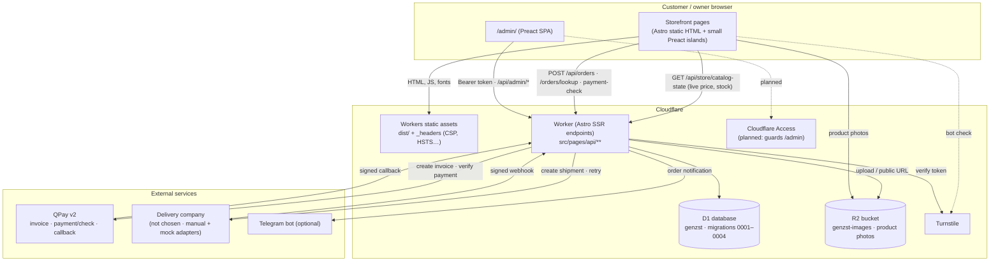
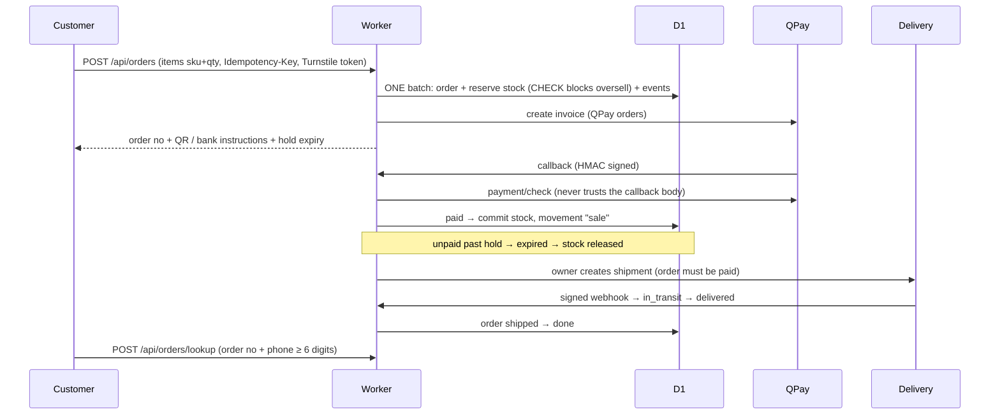

# genzst — system architecture, status and test plan

Updated 2026-11-20 · branch `genzst` · live: Cloudflare Workers (`genzst`, auto-deploy on push) and a static
GitHub Pages preview (`/online-shopping`, no backend).

## 1. Architecture



### Layers

| Layer | Where | Responsibility |
|---|---|---|
| Storefront | `src/pages`, `src/views`, `src/components`, `src/islands`, `src/scripts` | Static pages in Mongolian/English; JS only where needed (budget: checkout/finder ≤ 25 KB, home ≤ 90 KB). Prices and buy buttons come from the server at view time, never from the build. |
| Admin | `src/pages/admin`, `src/admin-ui` | Products, photos, SKUs, stock, orders, payments, shipments, webhooks, settings, audit. Owner/staff roles. |
| API | `src/pages/api/**` | Thin routes: auth → validate (zod) → call a lib module → JSON. |
| Domain libs | `src/lib/catalog`, `orders`, `payments`, `delivery` | Business rules. Every state change is one D1 batch with a conditional update. |
| Shared | `src/lib/contracts.ts`, `ids.ts`, `auth.ts`, `settings.ts`, `audit.ts`, `server.ts` | Types, state machines, permissions, store switches, audit rows, rate limiter. |
| Data | `migrations/0001–0004`, D1 | Orders, products, SKUs, reservations, payments, shipments, settings, audit, rate limits, webhooks. |
| Infra | `wrangler.jsonc`, `public/_headers`, `.github/workflows/pages.yml` | Bindings DB/MEDIA/ASSETS, security headers, CI to GitHub Pages. |

### Order flow



### State machines (`src/lib/contracts.ts`)

- Order: `new → confirmed → paid → shipped → done`, any non-final → `cancelled`.
- Reservation: `held → committed | released`. Payment: `pending → paid | failed | expired | cancelled`, `paid → refunded`.
- Shipment: `pending → created → picked_up → in_transit → delivered`, `failed → pending` (retry).
- Four sales switches: product **hidden**, product **sale-locked**, a **payment method off**, **checkout closed**.

### Roles

Owner (`ADMIN_TOKEN`): everything. Staff (`STAFF_TOKEN`): catalog read, stock, orders, payments read, delivery. Optional username+password
login exchanges for the token. Dev secrets are refused on any non-localhost host.

## 2. Verified status (what is actually tested)

Last full run on one fresh local D1 (2026-11-19, after the security hardening): order API 85, payments 45, delivery 85, storefront 57,
admin UI 96, e2e commerce 43, e2e real browser 17 — all pass; 24 page loads with 0 CSP violations; `astro check` 0 errors;
master-catalog unit test 3/3. Catalog suite (86) needs the now-tracked importer files: re-run it.

**Fails right now:** `npm run budget` → finder 25.1 KB and checkout 25.3 KB (limit 25).

## 3. What is missing — checklist

Legend: 🔴 blocks launch · 🟠 should fix before real customers · 🟡 later.

### Owner decisions / data
- [ ] 🔴 Real prices and stock for every SKU (all 1,123 products are not for sale; 916 are drafts needing gender, family, description).
- [ ] 🔴 Bank account, phone, socials (`src/data/settings.json`) and 19 `[[TODO owner]]` texts.
- [ ] 🔴 Image rights: R2 photos, `pic_chat/`, brand banners and ~100 hot-linked Shopify images are other brands' material; the CLAUDE.md rule needs a decision.
- [ ] 🔴 Make the repo private (or remove `decantx/` scraped data and `pic_chat/`; 30 tracked files).
- [ ] 🟠 Delivery company: name, API + webhook docs, sandbox. Questions: send the order note to the courier? re-ship after a cancelled shipment?
- [ ] 🟠 Privacy policy, terms, returns page and a consent line on checkout (none exist).
- [ ] 🟡 Customer accounts, wishlist sync, Top 3, reviews are demo (localStorage / fake data): make real or hide.

### Cloudflare configuration (only you can do it)
- [ ] 🔴 Secrets: `ADMIN_TOKEN` (≥ 24 random chars), real Turnstile site key + `TURNSTILE_SECRET`, `QPAY_USERNAME/PASSWORD/INVOICE_CODE/CALLBACK_SECRET`, optional `STAFF_TOKEN`, Telegram.
- [ ] 🔴 `PUBLIC_SITE_URL` = the real domain (it is `http://localhost:8788` in `wrangler.jsonc`; QPay callbacks are built from it); custom domain.
- [ ] 🔴 Cloudflare Access on `/admin/*` and `/api/admin/*` (free, email code).
- [ ] 🟠 `QPAY_BASE_URL` sandbox → production; confirm QPay calls the callback with GET or JSON POST.
- [ ] 🟠 Custom domain for images (`r2.dev` is for testing only); WAF/rate-limit rules and Bot Fight Mode on `/api/orders`.
- [ ] 🟠 D1 backups (Time Travel), error alerts, uptime check on `/api/health`.

### Code / quality
- [ ] 🟠 JS budget: finder and checkout over by 0.1–0.3 KB.
- [ ] 🟠 npm audit: 10 findings (1 critical in `astro`, 8 high) — upgrade separately, with the full test run.
- [ ] 🟠 QPay field names are verified only against a local mock: check against the official v2 docs.
- [ ] 🟠 Hold times: bank 24 h lets anyone block stock; consider 2–4 h and a per-phone cap.
- [ ] 🟡 No customer email/SMS confirmation; no order cancel/return flow for customers.
- [ ] 🟡 Mongolian/English strings written by Opus (admin, payment instructions) were never copy-reviewed.
- [ ] 🟡 Tests run only on a developer machine: add a CI job (build, check, budget, unit/API suites) — today CI only deploys Pages.
- [ ] 🟡 Real penetration test after deploying to a real domain.

## 4. Test plan — run it yourself

### A. Fully automated (no accounts needed)

```bash
npm ci
npx astro check                 # types: expect 0 errors
npx astro build
npm run budget                  # expect PASS (currently 2 pages over by ≤ 0.3 KB)
node --test scripts/test-master-catalog.mjs
```

Backend suites (one fresh local database, three terminals):

```bash
cp .dev.vars.example .dev.vars   # then point QPAY_BASE_URL=http://127.0.0.1:8892, QPAY_USERNAME=test, QPAY_PASSWORD=test,
                                 # QPAY_INVOICE_CODE=TEST_INVOICE, DELIVERY_BASE_URL=http://127.0.0.1:8893, DELIVERY_API_KEY=test-key
npx wrangler d1 migrations apply genzst --local --persist-to .wrangler/state-lead
node scripts/mock-qpay.mjs & node scripts/mock-delivery.mjs &
npx wrangler dev --port 8788 --persist-to .wrangler/state-lead
```

```bash
export BASE=http://localhost:8788 PERSIST=.wrangler/state-lead D1_PERSIST=.wrangler/state-lead
npm run test:catalog test:api test:payments test:delivery test:admin-api test:storefront test:admin-ui test:e2e
```

Expected (2026-11-19): catalog 86 · api 85 · payments 45 · delivery 85 · storefront 57 · admin-ui 96 · e2e 43 + 17.

### B. Manual checks on the live Cloudflare site

1. Open the site → DevTools → Network → document response has `content-security-policy`, `x-frame-options`, `strict-transport-security`.
2. Console on home, shop, product, checkout: no "Content Security Policy" errors; the Turnstile box appears on checkout.
3. `/admin/` → log in with the **production** token; the dev token must be refused (`insecure-secret`).
4. In admin: set a price + stock on one product → the product page shows that price within ~30 s; hide it → gone; lock sales → "Түр хаалттай".
5. Place a bank-transfer order (use a test phone) → order appears in admin, stock reserved; cancel it → stock back.
6. QPay (sandbox first): order → invoice QR → pay in sandbox → order turns "paid" without refresh.
7. `/api/health` returns ok; `GET /api/orders/lookup` returns 405.

### C. Security checks

- Without a token: every `/api/admin/*` → 401. Staff token: settings / mark-paid / product edit → 403.
- 6 orders from one IP in 10 minutes → 429. Wrong order-lookup phone ×11 → 429.
- Reload checkout after an order: no second order is created (Idempotency-Key).
- Run `npm audit --omit=dev` monthly; rotate `ADMIN_TOKEN` if it was ever shared in chat.

## 5. Suggested order of work

1. Repo private + Cloudflare secrets + `PUBLIC_SITE_URL` + Access on `/admin` (you).
2. Enter real prices/stock and bank details; fill `[[TODO owner]]` texts.
3. Sandbox end-to-end (steps B4–B6), then switch QPay to production.
4. Legal pages; fix the JS budget; dependency upgrade with the full suite.
5. Choose the delivery company and add its adapter; CI for tests; penetration test.
